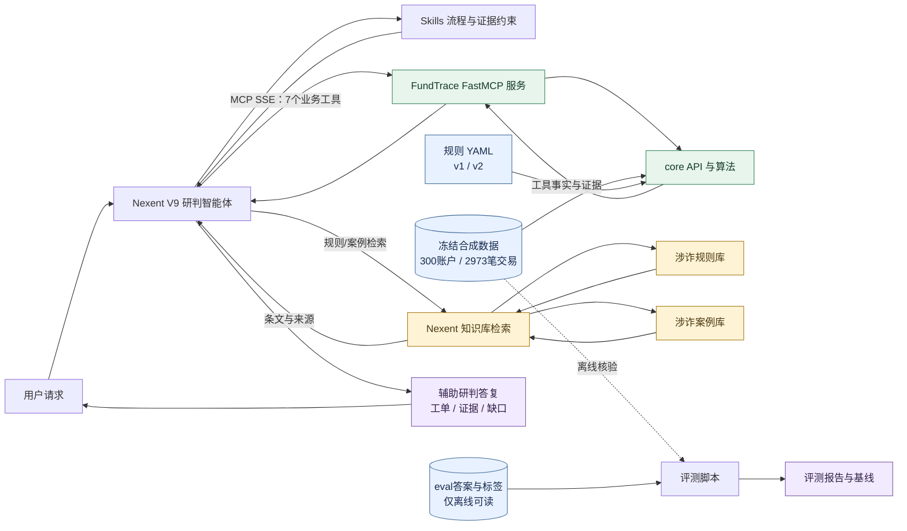
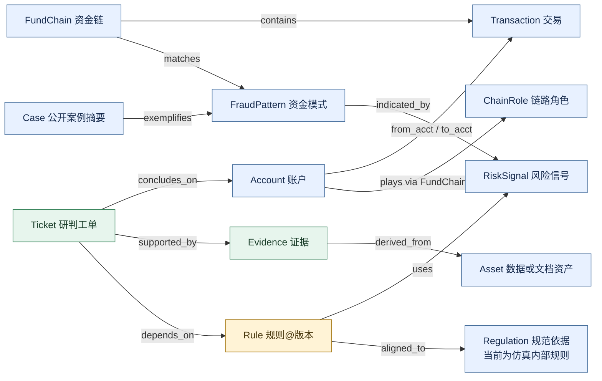

# FundTrace开发设计文档（校赛阶段）

版本：v0.1（讨论稿）  
日期：2026-11-03  
项目名称：基于仿真交易图的涉诈资金链路识别与证据工单辅助研判智能体  
平台：Huawei ModelEngine Nexent；业务工具通过FundTrace MCP服务提供

> 本文为Markdown格式开发设计文档初稿。校赛阶段实现和验证范围以当前仓库为准。账户与交易均为合成数据，规则参数为本作品仿真内部设定，不是真实金融数据或监管标准。本文不承诺真实业务效果、自动处置、跨租户迁移或尚未实现的多模态/本体自动演化能力。队伍、学校、成员、导师、比赛截止日期及正式模板待团队补充。

## 1. 项目概述

### 1.1 背景与问题

多层资金转移会分散在多个账户及不同时点。只看单笔交易难以呈现多来源汇入、短时中转或拆分转出结构；人工还要逐笔查流水、拼接路径、核对规则并整理说明。规则版本变化后，也需要重新判断已有数据下哪些账户结论发生变化。

本项目聚焦三个问题：

1. 如何根据交易方向、时间窗和节点资金守恒关系生成可解释链路，同时保留并行汇入等图结构？
2. 如何把账户状态和链路结果对应到交易编号、规则依据、反向证据和缺失证据？
3. 如何在同一数据集上比较不同规则版本，说明结论变化及其规则原因？

### 1.2 建设目标

- 在固定合成交易数据上提供账户、流水查询，资金链追踪，规则检查，研判工单生成与读取，规则版本重判。
- 将确定性业务计算封装为MCP工具，由Nexent智能体按流程调用。
- 通过规则知识库解释规则条文，通过案例知识库提供公开案例背景；知识库内容不作为当前账户的交易事实。
- 输出带来源、交易证据、反向证据和信息缺口的辅助研判答复，便于人工复核。
- 提供算法评测、协议自检、部署说明和交接材料，支持在合成场景内复现。

### 1.3 范围与边界

本阶段使用300个账户、2973笔交易的冻结合成数据，验证链路算法、规则判断、MCP接入、Nexent编排及规则版本比较。系统不连接真实银行数据，不作现实主体违法认定，不执行冻结、止付、处罚或其他自动处置。GNN、OCR、本体自动抽取/演化、真实数据测试和跨行业迁移均不属于当前已交付能力。

## 2. 整体方案设计

### 2.1 系统架构

```text
data/accounts.csv + data/transactions.csv + 规则YAML
                         |
                 core算法与数据仓库
   查询 / 时序资金链 / 规则 / 工单 / 版本重判
                         |
                   FastMCP服务
                         |
                 Nexent远程MCP连接
                         |
     V9智能体 + 三个Skill + 两个关联知识库
                         |
    带交易证据、规则出处和信息缺口的辅助研判答复
```

#### 系统架构图



实线表示在线请求和结果流；虚线表示离线评测。`eval`答案不进入MCP服务、core运行算法或智能体知识库。

模块职责：

| 模块 | 职责 | 主要实现/数据 |
|---|---|---|
| 数据与规范 | 定义账户、交易、规则、枚举和返回结构 | `data/`、`Data and Rules/` |
| 算法层 | 查询、追链、规则判断、工单、重判 | `core/store.py`、`core/api.py`及相关算法模块 |
| 服务层 | 暴露MCP工具、参数检查、服务自检 | `mcp_server/server.py`、FastMCP/SSE |
| 智能体编排 | 识别意图、加载Skill、调用工具、组织答复 | Nexent正式智能体V9及`agent/`配置 |
| 检索层 | 解释规则条文、提供公开案例摘要 | Nexent知识库“涉诈规则库”“涉诈案例库”，源文件在`kb/` |
| 评测层 | 依据注入答案核验链路与账户结果 | `eval/`及`core/evaluate.py`等评测脚本；生产工具不得读取答案 |

当前MCP服务共有8个工具：hello及7个业务工具。正式智能体使用业务工具与平台知识库检索能力。云端real模式对完整合成数据执行算法；“real”表示调用真实算法后端，不代表真实银行数据。

### 2.2 业务处理流程

1. 用户提出账户研判、已有工单读取、规则问答或版本比较请求。
2. 智能体按意图加载相应Skill；仅规则问答只检索规则库，不调用账户分析工具。
3. 单账户研判依次获取账户、流水、资金链和规则结果，按需要检索相应规则条文，再生成工单。
4. 只读工单请求仅调用`get_ticket`，不能悄悄重新生成工单。
5. 版本比较调用`rejudge`，展示工具返回的变化账户和原因；只有用户要求时才继续生成指定账户的新版本工单。
6. 输出严格区分工具事实与知识库规则解释，并声明合成数据及研判边界。

必要工具调用失败时，报告失败步骤并停止依赖该结果的结论，不补造证据或声称任务成功。交易路径按工具返回的有向edges描述；账户列表不代表连续路径。任何截断数据都必须明确标记。

### 2.3 主要业务工具

| 工具 | 用途 |
|---|---|
| `get_account` | 查询账户画像与统计字段 |
| `get_transactions` | 按账户、可选时间范围查询流水，返回总数及截断标志 |
| `trace_chain` | 按规则版本追踪资金链及账户角色 |
| `check_rules` | 计算风险规则命中和反向规则证据 |
| `make_ticket` | 根据工具结果生成结构化辅助研判工单 |
| `get_ticket` | 读取指定账户、规则版本的已有工单；具体缺失工单处理按服务实现 |
| `rejudge` | 比较规则版本在全体账户上的结果变化 |

MCP错误以约定错误对象返回。正式调用参数与JSON结构以`Data and Rules/03_判定与输出规范.md`、schema和代码为准。

## 3. 知识图谱构建方案

### 3.1 建模范围

本项目采用轻量、可解释的交易图和TBox概念模型，不部署独立图数据库，也不声称已实现从案例文本自动抽取实体或自动进化本体。

**交易实例图**由冻结CSV在`core.store`启动时装载并建立账户索引。账户为节点，满足规则筛选条件的转账为有向交易边，交易属性包括交易编号、时间、金额和类型。`CASH`为提现现金出口，不作为普通账户节点参与账户间链路。

**概念模型（TBox）**在`ontology/tbox_v1.yaml`中声明Account、Transaction、FundChain、ChainRole、FraudPattern、RiskSignal、Rule、Regulation、Case、Evidence、Ticket和Asset等概念及关系。账户/交易实例仍来自`data/`；概念模型文件不等于已加载到图数据库的实例知识图谱。

### 3.2 图构建与追链

1. 从数据仓库读取交易，依据当前规则版本的`trace`配置筛选候选转账边：类型符合、双方为已知账户、金额达到候选下限。
2. 对可能衔接的两笔交易检查账户连续性、严格时间递增及版本时间窗。
3. 同时检查中转账户时间窗内的向下和向上资金守恒比例。
4. 将满足链接条件的交易构成交易链接图，以弱连通分量形成候选资金链；按链金额门槛筛除不符合条件的分量。
5. 在链图上计算最长路径、源边、时长、账户角色和交易边。多个源点可以形成并行汇入；不得把账户集合排序误当作转账顺序。
6. 对外输出可根据查询账户与最大跳数裁剪边，并保留完整链路统计字段及`truncated`标志。

时间窗从规则版本配置读取：当前v1为60分钟，v2为120分钟，因此规则版本会影响链路识别结果。其他阈值、边类型和守恒比例以`Data and Rules/rules/rules_v*.yaml`为准。`core/trace.py`使用内存索引及图遍历/连通分量等逻辑，不依赖外部图数据库。

### 3.3 规则、证据与工单关系

规则以YAML作为机器可读权威定义；每个规则带版本、类型、实现名称和参数。规则命中输出关联证据交易编号；工单记录账户结论、链路角色、支持证据、反向证据、缺失证据、规则依据和建议动作。`aligned_to`当前指向“仿真内部规则vN#Rxx”，不表示已对齐真实监管条文。公开案例摘要用于说明手法背景，不能作为任一演示账户的交易证据。

概念关系可概括为：



该图表达`ontology/tbox_v1.yaml`中的概念及关系定义，不表示这些对象已存入独立图数据库；账户、交易实例来自冻结CSV，工单来自工具计算结果。

### 3.4 图谱校验与当前限制

图链和角色实现以`core/trace.py`为准，规范参考实现位于`Data and Rules/validate_spec.py`，评测答案仅供离线核验。图链边方向、时间顺序、证据编号和链路统计需通过单元测试、规范校验及评测脚本核对。运行算法不得读取`eval/answer*.csv`。

当前是基于冻结CSV构建的内存交易图和人工维护的轻量TBox；尚无图数据库持久化、自动案例实体链接、知识抽取流水线、图谱版本差分服务或真实机构本体映射。后续若纳入这些内容，需单独设计数据授权、实体消歧、人工审核和增量更新验收。

## 4. 智能体构建方案

### 4.1 平台与配置

- 平台：Nexent，正式智能体名称“涉诈资金链路研判助手”。
- 当前发布版本：V9 `fundtrace-v1.2-三技能-20261031`。
- 模型：DeepSeek-V4.1-Flash；运行最大步数15；协议修复开启；平台记忆关闭（据既有验收记录）。
- 工具：绑定FundTrace MCP的7个业务工具；MCP服务另有hello连通性工具。
- 知识库：涉诈规则库、涉诈案例库。正式平台检索是否返回内容和引用，以调用记录及可打开来源为准。

目标平台或租户导入时，MCP连接、模型凭据、Embedding、知识库索引和Skills绑定需分别检查；Nexent配置ZIP不自动迁移这些外部资源。当前已验证同租户副本恢复，不能表述为跨租户迁移通过。

### 4.2 三个Skills职责

| Skill | 职责 |
|---|---|
| `evidence-citation` | 约束证据编号、来源标注、工具事实与知识库引用边界 |
| `fund-chain-investigation` | 编排单账户画像、流水、追链、规则、检索及工单步骤 |
| `rule-update-rejudge` | 编排规则版本比较、差异解释及用户要求的指定账户新版本工单 |

技能只负责流程和表达约束，不替代MCP计算，也不授予系统权限。账户研判前按提示词要求加载证据技能和研判技能；版本比较按需加载证据技能与重判技能；只读工单不调用生成工具；纯规则问题只检索规则库。

### 4.3 知识库与回答约束

- 规则库文档由规则YAML生成，说明规则名称、条件、参数和版本差异。规则YAML是计算口径的权威来源。
- 案例库包含带来源的公开报道摘要。摘要中的规则映射属于本作品解释，不能证明演示账户事实或规则阈值。
- 回答分开呈现“工具事实”和“规则定义与来源”。账户、交易、金额、方向、状态和工单只来自工具返回；知识检索只用于解释规则。
- 必须注明数据为合成数据和对应数据集；禁止违法定性、自动处置建议或超出工具结果的金额推算。
- 保留测试异常、正文遗漏、格式问题及修订后的回归记录，不用成功轮替代整体稳定性结果。

### 4.4 验收设计

主要问题集覆盖：规则R01问答、A0209/v1链路研判、A0105反向证据、A0176/v2规则重判和新工单、只读工单、无效账户A9999。每次验收同时核对实际Skill/工具调用、工具返回字段、交易双方及方向、交易编号、合成数据声明和最终正文完整性。界面显示“已完成”本身不是通过条件。

仓库记录的V9草稿15次/51份业务返回、发布后7次/19份、同租户恢复10次/22份是不同测试组；自动检查有14/15无告警及1条人工复核记录，恢复曾发生正文遗漏。补丁后A0209和A0044演示工单方向已复测，但这些复测不能外推为任意问法稳定或所有工单均刷新。

## 5. 原始数据说明

### 5.1 数据来源及文件

本阶段不采集真实个人或金融机构数据。数据由仓库`core/gen_data.py`按照`Data and Rules/gen_profile_v1.yaml`和随机种子42生成，数据集编号为`sim-gen_profile_v1-seed42`。正式数据冻结后，禁止直接重新生成覆盖。

| 文件 | 内容 | 规模/用途 |
|---|---|---|
| `data/accounts.csv` | 账户编号、合成名称、账户类型、开户日期 | 300个账户：个人250、商户30、企业20 |
| `data/transactions.csv` | 交易编号、分钟级时间、付款方、收款方、金额、交易类型 | 2973笔，按时间和交易编号排序 |
| `data/dataset_meta.json` | 数据集编号、版本、随机种子、时间范围、行数、CSV SHA256 | 数据身份和冻结完整性校验 |
| `Data and Rules/rules/rules_v1.yaml`、`rules_v2.yaml` | 机器可读规则参数与追链配置 | 算法配置来源 |
| `eval/answer.csv`、`eval/answer_tx.csv` | 离线账户及交易级预设答案 | 只用于评测，生产工具和MCP不得读取 |

交易时间覆盖2026-03-01 00:00至2026-03-07 23:59，时区口径为Asia/Shanghai本地时间。交易包含背景个人转账、消费、工资，以及注入的链路转账和提现等类型。按数据生成说明，设置了快进快出6条、分层中转3条、拆分转出3条，共12条预设链，并包含工资、商户经营和合租转发等干扰场景。每类数据的细节以`data/README.md`和生成规范为准。

### 5.2 数据格式与标识

CSV为UTF-8、LF换行、逗号分隔。账户编号遵循`A\d{4,}`，交易编号遵循`T\d{5,}`，时间为`YYYY-MM-DD HH:MM`，金额单位为人民币元。账户关系由交易表中的`from_acct`和`to_acct`表示；提现现金出口`CASH`不是账户表中的普通账户。CSV不含风险标签。

完整列定义、枚举、空值、排序和跨表约束，以`Data and Rules/data_schema_v1.yaml`、`enums.yaml`及对应说明为准。CSV字节哈希记录在`dataset_meta.json`，Windows检出时须防止自动换行转换破坏冻结哈希。

## 6. 数据处理说明

### 6.1 生成与冻结

合成背景和注入链由生成脚本按唯一随机种子生成。冻结后记录数据集元信息和SHA256；日常检查仅读取数据，不运行`--force`覆盖正式集。若因研究需要产生新数据集，应使用新版本/新目录、更新标签和演示账户并重新执行全套核验，不能沿用旧哈希或旧结论。

### 6.2 装载与规范化

`core/store.py`在服务启动后读取账户及交易CSV，校验/转换金额和时间字段，并建立账户、交易和按账户索引，供查询与算法使用。业务API对账户号、时间、limit、跳数和规则版本进行参数检查；无效输入以约定错误结构返回。MCP以`MCP_MODE=real`连接完整算法模式时，读取该冻结合成数据集。

处理流程不把标签合并到运行数据。离线答案目录`eval/`与生产服务隔离；`validate_spec.py --check-leak`检查核心工具代码是否错误引用评测答案。

### 6.3 规则计算、证据生成与评测

1. 按规则YAML加载指定版本参数，不进行服务级全局版本切换。
2. 对交易计算候选边、时间衔接、守恒和连通分量，形成链路及角色。
3. 对每个账户独立计算风险命中和反向规则命中，保留交易编号及关键参数。
4. 工单组合链路、规则、支持/反向/缺失证据，并明确建议动作；方向描述须保留真实付款方和收款方。
5. 版本重判在同一数据上分别运行旧版和新版规则，比较状态、角色、链路及规则变化。
6. 评测脚本将系统输出与`eval/`中的账户/交易级答案比较，生成`eval/result.md`和`eval/baseline.md`。评测指标仅描述当前种子和定义，不作为真实世界准确率。

### 6.4 质量、隐私和安全控制

- 运行前后校验CSV哈希、规范、schema、fixtures、规则文档、测试、工单和资产清单。
- MCP及Nexent只使用工具返回事实；不把知识库案例、提示词示例或历史工单拼接为新账户事实。
- 交付包采用文件白名单；不包含虚拟环境、运行日志、浏览器会话或密钥。内部配置标识仅限团队内部传递。
- 合成账户名称仍按项目内部材料处理；公开展示前移除登录信息、服务器凭据、租户标识及无关个人信息。
- 云服务更新先备份服务文件和演示工单，再部署、自检及有限演示账户复测；禁止为清理样例而批量删除不相关工单。

## 7. 实施安排与分工

| 阶段 | 当前状态 | 责任人 | 主要产物 |
|---|---|---|---|
| 数据、规范与接口约定 | 已完成并留档 | 甲牵头，乙配合 | 数据规范、规则YAML、冻结数据、接口记录 |
| 算法、评测与图表 | 已完成现有校赛基线 | 甲 | core算法、评测结果、基线、链路图、资产表 |
| MCP服务和云端部署 | 已完成并有real自检及恢复记录 | 乙 | FastMCP服务、部署/自检/恢复说明 |
| Nexent智能体和技能 | V9发布并完成有限回归 | 乙 | 智能体配置、三个Skill、双知识库和测试日志 |
| 校赛文档、PPT和演示 | 进行中 | 丙牵头，甲乙复核 | 计划书、开发设计文档、PPT、≤3分钟演示视频 |
| 提交前冻结与核验 | 待比赛日期/模板确认 | 全组及指导教师 | 版本、哈希、成员信息、提交清单 |

校赛后若团队批准，可单独立项评估多随机种子、参数偏移、真实脱敏数据或跨场景迁移；需另行定义数据授权、基线和验收标准。

## 8. 验收和复现入口

在仓库根目录安装`requirements.txt`后，按根`README.md`运行规范和数据校验以及`python core/run_checks_jia.py`。MCP服务自检见`mcp_server/README.md`、`UPGRADE_REAL.md`和`SYSTEMD.md`。Nexent平台调用验收、V9回归边界及演示问题见`agent/handoff/README.md`、`DEMO.md`、`演示讲解稿.md`和`agent/test_log.md`。

评测数据和答案只供离线评测使用。完成本地核验不等于目标Nexent环境导入、跨租户迁移或真实数据部署成功；每个目标环境应单独记录安装和验收结果。

## 9. 待团队确认

- 学校、队伍名称、成员真实姓名及分工、指导教师。
- 校赛截止日期、现场演示时长和开发设计文档正式模板/格式。
- 云服务器和模型服务预算、账号负责人及后续费用承担。
- PPT、视频、截图的最终接收人和审核安排。
- 本Markdown是否需按赛事模板补充封面、审批页、进度甘特图或签字栏。

## 10. 资料索引

- 总体计划草案：[项目计划书初稿_校赛阶段.md](项目计划书初稿_校赛阶段.md)
- 数据说明：[data/README.md](data/README.md)
- 权威数据与规则规范：[Data and Rules/README.md](Data%20and%20Rules/README.md)
- 追链方法和评测数字：[eval/handoff/METHOD.md](eval/handoff/METHOD.md)、[eval/handoff/NUMBERS.md](eval/handoff/NUMBERS.md)
- 平台交接与演示：[agent/handoff/README.md](agent/handoff/README.md)、[agent/handoff/DEMO.md](agent/handoff/DEMO.md)、[演示讲解稿](agent/handoff/演示讲解稿.md)
- 原长期选题方案：[涉诈资金链路研判_选题规划与实施方案.md](涉诈资金链路研判_选题规划与实施方案.md)
